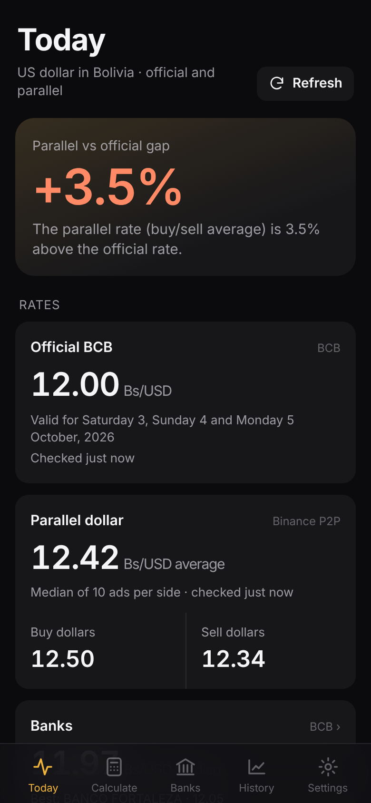
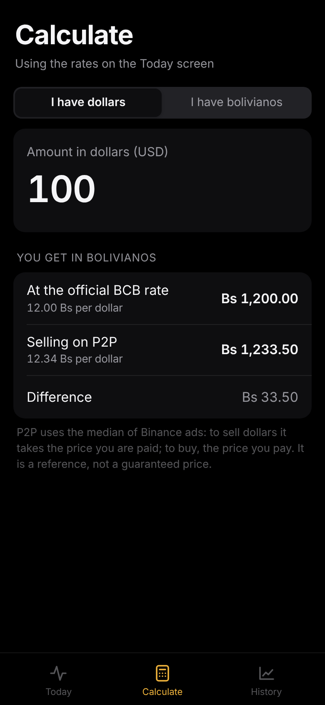
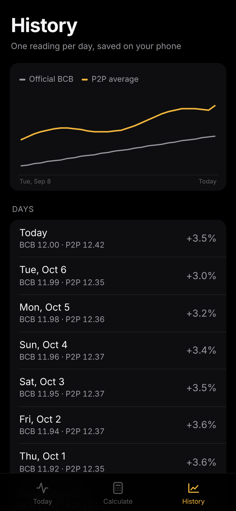
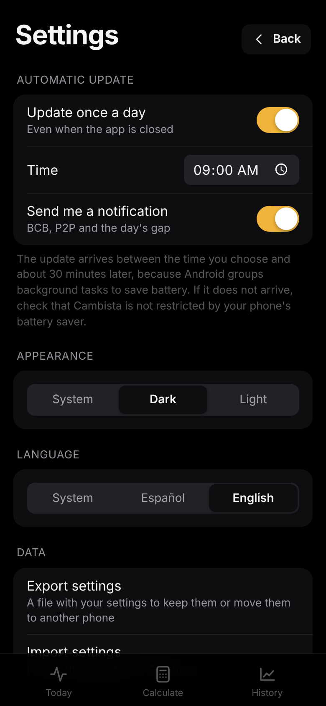

# Cambista

Follow Bolivia’s US dollar exchange rate with Cambista on Android and the web. See the **official BCB rate**, the **Binance P2P rate (USDT)**, and the **gap** between them. Use the calculator to estimate what you would receive. On Android, you can pick a time for the daily update and get a notification.

📊 **OFFICIAL VS PARALLEL AT A GLANCE:**
The Today screen shows the official rate from the Central Bank of Bolivia (with its validity dates), the P2P buy, sell and average prices, and the gap = P2P / BCB − 1, explained in plain words. It also shows how much each rate moved since yesterday and whether today's P2P price is cheap or expensive compared with the last 7 and 30 days.

🧮 **BUILT-IN CALCULATOR:**
Choose "I have dollars" or "I have bolivianos" and see what you get at the official rate and on P2P, plus the difference. P2P uses the price you are paid when you sell and the price you pay when you buy. Tap **Price for your amount** to see what Binance ads that actually accept your amount (many have a minimum or maximum) are paying right now.

📈 **DAILY HISTORY & CHART:**
One reading per day, saved on your phone, with a chart of the last 30 days and the gap for each day. Export it to CSV for Excel or Google Sheets, and import it back on a new phone.

⏰ **AUTOMATIC DAILY UPDATE:**
Pick a time and Cambista checks the rates in the background, even when the app is closed, and notifies you with the BCB rate, the P2P rate and the gap.

🛟 **RELIABLE SOURCES WITH BACKUPS:**
If a main source fails, Cambista falls back to another one and tells you which source each number came from.

| Data | Main source | Other sources (if the main one fails) |
|---|---|---|
| Official dollar | Home page of the [BCB](https://www.bcb.gob.bo/) ("Tipo de cambio oficial") | DolarApi `/v1/dolares/oficial` |
| Parallel dollar | Binance P2P USDT/BOB: median of the first N buy and sell ads | [paralelo.bo](https://paralelo.bo/api) (data under CC BY 4.0), then DolarApi |

🔐 **ANDROID PRIVACY:**
No accounts, no analytics, no location permission, no server. Your settings and history never leave your phone.

🌐 **SPANISH & ENGLISH:**
Use the phone's language or choose Español or English in Settings. Numbers and the daily notification follow the language you pick. You can also export your settings to a file and import them on another phone.

🌙 **CLEAN, MODERN DESIGN:**
Dark (pure black, easy on OLED screens) and light themes, or follow the system, large numbers that are easy to read, and a simple three-tab layout (Today, Calculate, History) with Settings behind the gear on the Today screen.

Screenshots with sample data.

## Use Cambista in your browser

Open [Cambista Web](https://dani3lsamir.github.io/Cambista/) to compare the official BCB rate with Binance P2P, convert an amount and explore the rate history. GitHub Actions collects the quotes at 30-minute intervals. The page shows the time of the latest observation.

## Install on Android

1. On your phone, open the [latest release](https://github.com/dani3lsamir/cambista/releases/latest) and download `Cambista.apk`.
2. Open the APK on your Android phone and allow "install unknown apps" for your browser or file manager.

New versions install over the old one without losing your history.

## For developers

Build, test and project structure notes (in Spanish) are in [docs/DESARROLLO.md](docs/DESARROLLO.md). Planned features are in [docs/ROADMAP.md](docs/ROADMAP.md).

## Disclaimer

Cambista is for information only. Rates can change at any time and are not an offer to buy or sell.

## License

Copyright (C) 2026 dani3lsamir

Cambista is free software: you can redistribute it and/or modify it under the terms of the
[GNU General Public License](LICENSE) as published by the Free Software Foundation, either
version 3 of the License, or (at your option) any later version. It is distributed in the hope
that it will be useful, but WITHOUT ANY WARRANTY; without even the implied warranty of
MERCHANTABILITY or FITNESS FOR A PARTICULAR PURPOSE. See the GNU General Public License for
more details.
